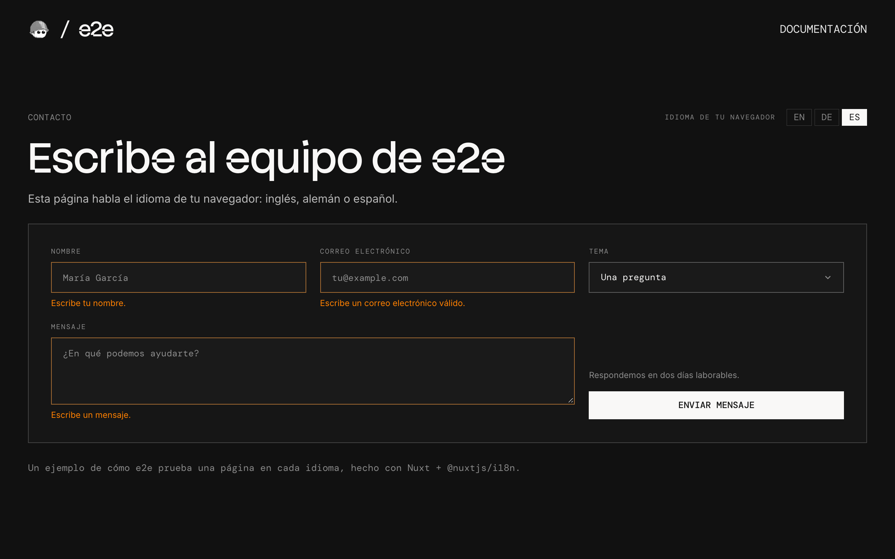

# e2e-i18n

A contact form in English, German, and Spanish, with the language taken from the browser, used as an example of end-to-end testing every language with one test file with [e2e](https://www.npmjs.com/package/e2e).



## How it works

The page speaks whatever language the browser asks for:

- **Nuxt's i18n module** (`nuxt.config.ts`) reads the browser's `Accept-Language` on the server, so the first HTML is already translated and `<html lang>` matches. There's one URL and no cookie: change the browser's language and the page follows.
- **The strings** live in `i18n/locales/`, one file per language. A string missing from one falls back to English (`i18n/i18n.config.ts`).
- **The form** (`app/components/ContactForm.vue`) checks its fields in the browser and thanks you by name. Nothing is sent or stored.

### Languages

| Browser language                         | Page    |
| ---------------------------------------- | ------- |
| German (`de-DE`, `de-AT`, …)             | Deutsch |
| Spanish (`es-ES`, `es-MX`, …)            | Español |
| English (`en-US`, `en-GB`, …) or another | English |

## Getting started

```bash
npm install
npm run dev
```

Open [http://localhost:3000](http://localhost:3000).

To see another language, change your browser's: in Chrome, open Settings → Languages, move Deutsch or Español to the top, and reload.

## End-to-end tests

Every test runs once per language. `e2e.config.ts` has one target per browser locale (`en-US`, `de-DE`, `es-ES`), so the browser asks for that language and the page answers in it.

- **`tests/home.e2e.ts`** uses test ids, attributes, and stored screenshots, never text, so it runs unchanged in every language and needs no key. It checks the page's `lang`, the form's errors, a screenshot of the form in each language, and that no text is wider than its box, since German and Spanish run longer than English.
- **`tests/languages.e2e.ts`** is written once, in English, and each agent step goes to a persona who reads the target's language: on the German target, a German reader finds "Nachricht senden" by itself. The personas fill in and send the form, check that no text is left in another language, and check that nothing is cut off. On their first run, they found the logo link's screen-reader label still in English.

The personas' model goes through the Vercel AI Gateway, so copy `.env.example` to `.env.local` and set `AI_GATEWAY_API_KEY` (or link a Vercel project); without it, the persona tests skip. Then, with the dev server running:

```bash
npm run test:e2e
```

`npx e2e run --target de` runs one language. The stored screenshots in `tests/home.e2e.ts-snapshots/` are from headless Chromium on macOS: with `--headed`, that test skips, since a headed browser draws small text a little differently, and on another system, run `npx e2e run --update-snapshots` once and check the new ones. To test a different URL, set `APP_URL`. Configuration lives in `e2e.config.ts`.

## Scripts

| Command             | Description          |
| ------------------- | -------------------- |
| `npm run dev`       | Start the dev server |
| `npm run build`     | Build for production |
| `npm run preview`   | Preview the build    |
| `npm run lint`      | Run ESLint           |
| `npm run format`    | Format with Prettier |
| `npm run typecheck` | Check types          |
| `npm run test:e2e`  | Run the e2e tests    |
